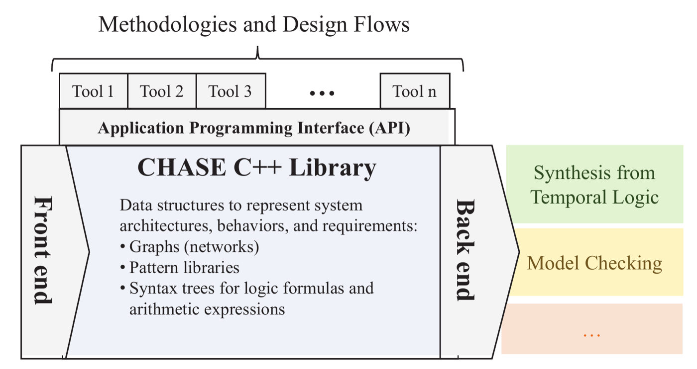

# Contract-based Heterogeneous Analysis and Systems Exploration (CHASE)

CHASE is a framework for requirement capture, formalization, and validation
for cyber-physical systems. It features a modular and extensible software
infrastructure that can support different domain-specific languages, modeling
formalisms, and analysis tools.

<p align="center">
  
</p>

The front-end modules parse the specification languages and build the CHASE
representation of a design problem. The CHASE libraries represent and
manipulate systems, behaviors, and contracts. The back-end modules translate
the problems into the languages of verification and synthesis tools (figure
from the [DATE 2018 paper][DATE18]).

This repository is the entry point to CHASE. It collects the CHASE modules as
git submodules, and it provides the scripts to build and install all of them
at once. Each module is developed in its own repository.

## Repository structure

- `modules/core-library`: the library providing the classes and structures to
  represent design problems and systems, and their Python bindings
  ([chase-cps/core-library][CORE]).
- `modules/chase-backends`: the backends encoding CHASE problems into external
  tools, i.e., Slugs, GR1C, NuSMV, and PySTL ([chase-cps/chase-backends][BACKENDS]).
- `modules/DSL_tool`: the tool using a Domain Specific Language to specify
  discrete timed problems over architectures modeled as graphs
  ([chase-cps/DSL_tool][DSL]).
- `modules/logics_tool`: the tool providing a console to manipulate
  assume-guarantee contracts expressed using a logics-based language
  ([chase-cps/logics_tool][LOGICS]).
- `modules/third_party`: the third-party libraries required to build CHASE,
  i.e., the ANTLR4 C++ runtime ([chase-cps/third_party][THIRD]).
- `demos`: demonstrations and benchmarks of CHASE ([chase-cps/demos][DEMOS]).
- `legacy`: demos of the monolithic version of CHASE developed until 2022,
  which are no longer maintained.
- `python`: the `chase_cps` Python package (contracts, contract algebra, and
  the interface to the model checkers and synthesis tools).
- `tests`: a script running all the demos and checking their results.

## Quick start

The complete CHASE toolchain, including the gr1c, slugs, and NuSMV solvers,
is available as a Docker image:

````
$>  git clone --recursive https://github.com/chase-cps/chase
$>  cd chase
$>  docker build -t chase .
$>  docker run --rm -it chase
````

The container starts in the directory of the demos. All the demos can be run
and checked with:

````
$>  docker run --rm chase /opt/chase/tests/demo-suite.sh
````

NuSMV is distributed only for x86_64. On ARM machines (e.g., Apple Silicon),
add `--platform linux/amd64` to the `docker build` and `docker run` commands
to include it in the image.

## Installation from sources

CHASE requires CMake (version 3.18 or higher), a C++ compiler supporting C++17,
Python 3 with its development files, and pybind11. On Ubuntu, they can be
installed with:

````
$>  sudo apt-get install build-essential cmake git python3-dev pybind11-dev uuid-dev
````

On macOS, with [Homebrew](https://brew.sh):

````
$>  brew install cmake pybind11
````

Then, clone the repository with its submodules and run the installation
script:

````
$>  git clone --recursive https://github.com/chase-cps/chase
$>  cd chase
$>  ./install.sh /path/to/install/directory
````

If no directory is given, CHASE is installed in the `install` directory of the
repository. At the end, the script prints the lines to add to the shell
configuration file to use the tools and the Python modules, i.e.:

````
export PATH="/path/to/install/directory/chase/bin:$PATH"
export PYTHONPATH="/path/to/install/directory/chase/lib:$PYTHONPATH"
````

The Python modules are built for the interpreter given by the `PYTHON`
environment variable (by default, `python3`), and they can only be imported by
that version of Python. For instance:

````
$>  PYTHON=python3.13 ./install.sh /path/to/install/directory
````

The script runs the CMake superbuild defined in `CMakeLists.txt`, which builds
and installs the modules in the required order. The superbuild can also be
used directly:

````
$>  cmake -S . -B build -DCMAKE_INSTALL_PREFIX=/path/to/install/directory
$>  cmake --build build
````

It accepts the following options:
- `CMAKE_INSTALL_PREFIX`: the installation directory (default: `build/install`).
- `CMAKE_BUILD_TYPE`: the build type (default: `Release`).
- `CHASE_BUILD_TESTS`: builds the tests of the core library, which are then
  run by `ctest --test-dir build` (default: `OFF`).
- `Python_EXECUTABLE`: the Python interpreter the Python modules are built
  for. `PYTHON_EXECUTABLE` is accepted as well.
- `pybind11_DIR`, `CMAKE_PREFIX_PATH`: forwarded to all the modules to find
  pybind11. On macOS, pybind11 installed with
  Homebrew is found with `-DCMAKE_PREFIX_PATH=$(brew --prefix)`.

To update an existing copy of the repository:

````
$>  git pull
$>  git submodule update --init --recursive
$>  ./install.sh /path/to/install/directory
````

The external tools used by the backends are not installed by the script. They
are available at the following locations:
- [gr1c](https://github.com/tulip-control/gr1c)
- [slugs](https://github.com/VerifiableRobotics/slugs)
- [NuSMV](https://nusmv.fbk.eu/)
- [nuXmv](https://nuxmv.fbk.eu/)

## Python package

The `chase_cps` package, in the `python` directory, provides contracts written
in the standard LTL syntax, the contract algebra of the core library, and a
common interface to the external tools: implication, satisfiability,
refinement, consistency, and compatibility checks with
[nuXmv](https://nuxmv.fbk.eu/) or [NuSMV](https://nusmv.fbk.eu/), and GR(1)
realizability with slugs. A failed check returns a counterexample trace.

The package, together with the compiled CHASE modules, is installed with:

````
$>  pip install chase-cps
````

or, from the sources:

````
$>  git clone --recursive https://github.com/chase-cps/chase
$>  cd chase
$>  pip install .
````

The checks call external tools, which are installed separately: nuXmv or
NuSMV for the implication, refinement, consistency, and compatibility checks,
and slugs for realizability. `chase-cps doctor` shows the tools found and how
to install the missing ones. The details are in the
[package README](python/README.md).

For instance:

````
from chase_cps import Contract, refines

spec = Contract.from_strings(inputs=["req"], outputs=["grant"],
                             assumptions=["G F !req"],
                             guarantees=["G (req -> F grant)"], name="Spec")
impl = Contract.from_strings(inputs=["req"], outputs=["grant"],
                             guarantees=["G (req -> X grant)"], name="Impl")
print(refines(impl, spec).status)
````

The tests are run with `pytest`. The operations of CHASE are also available
to AI agents through the [CHASE MCP server](https://github.com/chase-cps/chase-mcp).

## Documentation

- [CHASE website](https://chase-cps.github.io)
- [Python API reference](https://chase-cps.github.io/api/)
- [Tools](https://github.com/chase-cps/core-library/blob/main/doc/md/tools.md)
- [Python interface](https://github.com/chase-cps/core-library/blob/main/doc/md/python.md)
- [Demos](https://github.com/chase-cps/demos)

Each module also contains its own documentation in its repository.

## License

CHASE is released under the 3-Clause BSD License. The license of each module
is available in the corresponding repository. The ANTLR4 C++ runtime in
`modules/third_party` is distributed under its own license.

## Citation

CHASE has been presented at the IEEE/ACM Design, Automation and Test in Europe
(DATE) conference 2018. To cite CHASE in an academic work, please use the
following bibtex entry:

````
@inproceedings{CHASE:2018:DATE,
  title={CHASE: Contract-based requirement engineering for cyber-physical system design},
  author={Nuzzo, Pierluigi and Lora, Michele and Feldman, Yishai A and Sangiovanni-Vincentelli, Alberto L},
  booktitle={Proceedings of the Design, Automation \& Test in Europe Conference \& Exhibition (DATE) 2018},
  pages={839--844},
  year={2018},
  organization={IEEE}
}
````

[CORE]: https://github.com/chase-cps/core-library
[BACKENDS]: https://github.com/chase-cps/chase-backends
[DSL]: https://github.com/chase-cps/DSL_tool
[LOGICS]: https://github.com/chase-cps/logics_tool
[THIRD]: https://github.com/chase-cps/third_party
[DEMOS]: https://github.com/chase-cps/demos
[DATE18]: https://past.date-conference.com/proceedings-archive/2018/pdf/0451.pdf
